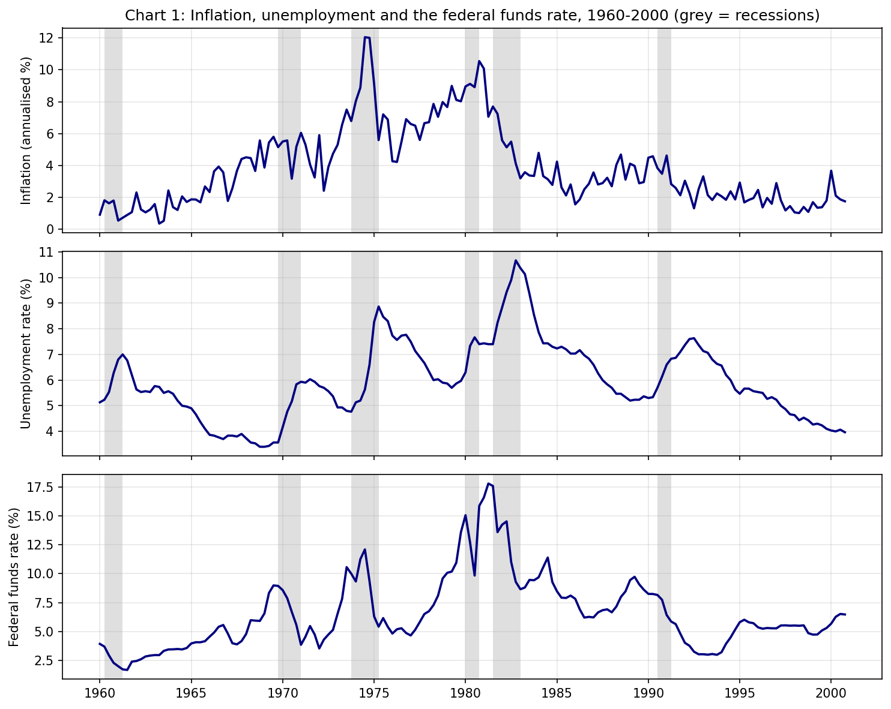
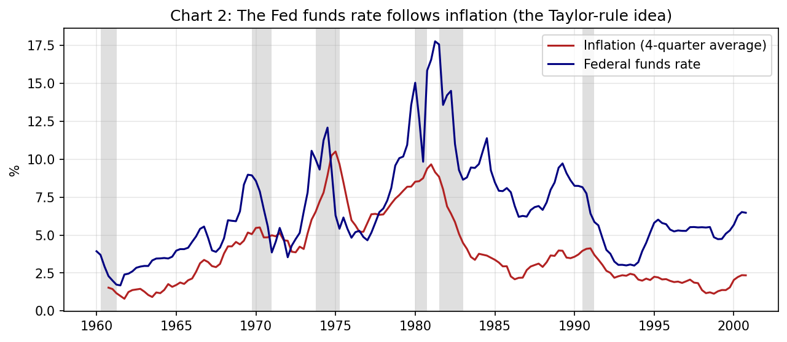
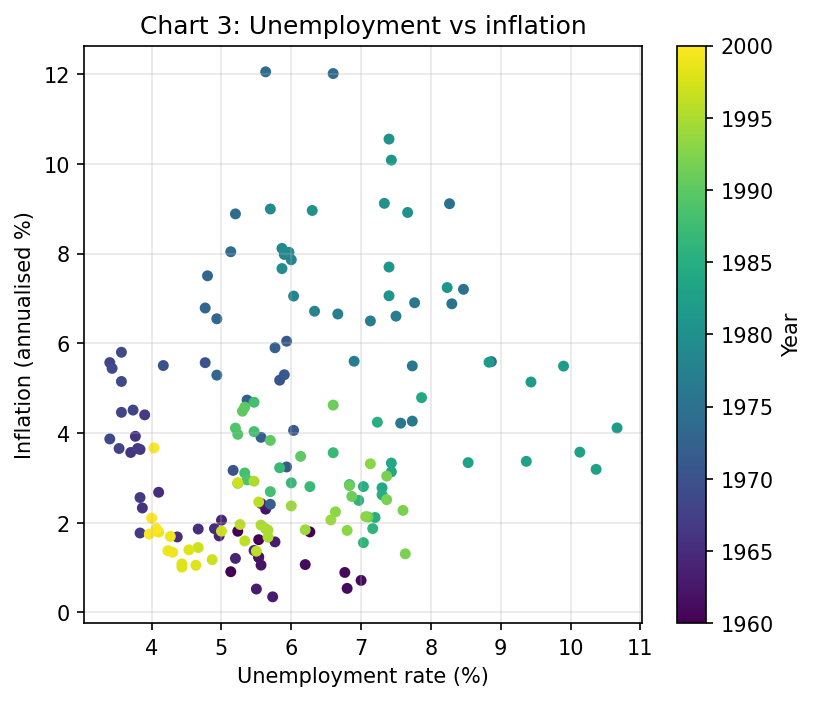
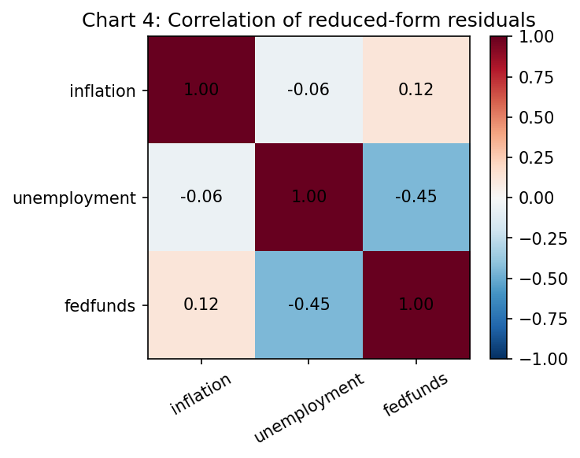
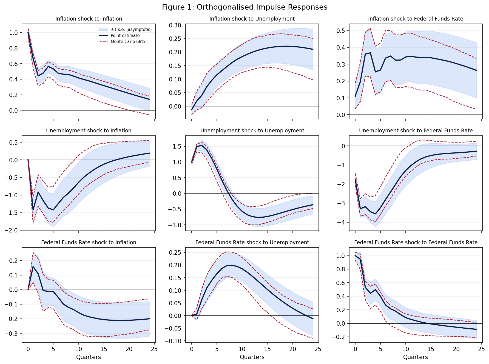
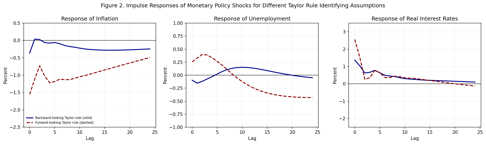

# Vector Autoregressions for Macroeconomic Analysis: A Full Replication of Stock and Watson (2001)

An end-to-end Python replication of Stock and Watson's "Vector Autoregressions" (*Journal of Economic Perspectives*, 2001), estimating a three-variable VAR of inflation, unemployment and the federal funds rate to describe macroeconomic dynamics through Granger-causality tests, variance decompositions and impulse responses, benchmark its out-of-sample forecasts against random-walk and autoregressive models, and show how structural conclusions about monetary policy hinge on the identifying assumption. 

## Research Question

What does a small macroeconomic VAR reveal about the dynamic relationships among inflation, unemployment and monetary policy, and how far do its conclusions depend on identifying assumptions?

Stock and Watson assess VARs on four tasks: data description, forecasting, structural inference and policy analysis. This project replicates the evidence for the first three:

| Paper result | What it shows |
|---|---|
| Table 1.A | Granger-causality tests |
| Table 1.B | Forecast error variance decompositions (recursive VAR) |
| Figure 1 | Impulse responses, recursive VAR |
| Table 2 | Pseudo out-of-sample forecast RMSEs (RW, AR, VAR) |
| Figure 2 | Monetary policy shocks under two Taylor-rule identifications |

## Data

| Item | Description |
|---|---|
| Frequency | Quarterly |
| Sample | 1960Q1 to 2000Q4 (164 observations) |
| Variables | Inflation, unemployment rate, federal funds rate |
| Observations used in estimation | 160 (the first four are used as lags) |

The data file `SW2001_Data.xlsx` comes from the replication materials in the VAR Toolbox of Ambrogio Cesa-Bianchi (Bank of England):
https://github.com/ambropo/VAR-Toolbox/blob/main/Replic/SW2001/SW2001_Data.xlsx

Following the paper:

- Inflation is the annualised quarterly rate of change of the GDP price index:

<p align="center">
  
</p>

- The unemployment rate and the federal funds rate are quarterly averages of monthly values.
- All variables are used in levels. Nothing is differenced, because the aim is to reproduce the published specification.

The loader checks that the data are unique, sorted, complete and have exactly 164 observations from 1960Q1 to 2000Q4.

## Exploratory Analysis



*Figure 1. Inflation, unemployment and the federal funds rate, with recessions shaded. Inflation and interest rates rise through the 1970s and peak around 1980 to 1981, then fall. Unemployment rises in each recession.*



*Figure 2. The federal funds rate and the four-quarter average of inflation. The two move together, which is the idea behind a Taylor rule.*



*Figure 3. Unemployment against inflation, coloured by year. There is no stable negative relationship, and the 1970s show high inflation together with high unemployment.*



*Figure 4. Correlations of the reduced-form VAR residuals. The residuals are contemporaneously correlated, which is why impulse responses require an identifying assumption.*

Augmented Dickey-Fuller tests are reported as a diagnostic only. They do not reject a unit root at the 5% level for inflation (p = 0.327) or the funds rate (p = 0.140), and unemployment is borderline (p = 0.055). The variables stay in levels to match the original specification.

## Methodology

### Reduced-form VAR

A VAR(4) with a constant is estimated by OLS, equation by equation:

<p align="center">
  
</p>

The estimated system is stable: all eigenvalues of the companion matrix lie inside the unit circle.

### Granger causality (Table 1.A)

For each pair of variables, the null hypothesis is that the four lags of the predictor do not enter the equation of the dependent variable:

<p align="center">
  
</p>

The test is an F-test on the estimated VAR. The code uses `test_causality` from statsmodels, which tests different variables and so leaves the diagonal of the table blank.

### Recursive identification (Table 1.B and Figure 1)

Reduced-form residuals are correlated across equations. A Cholesky decomposition of their covariance matrix gives uncorrelated shocks:

<p align="center">
  
</p>

The ordering is inflation, unemployment, federal funds rate. Inflation does not respond within the quarter to the other two variables, and the funds rate responds within the quarter to both. The code verifies numerically that P·P′ equals the residual covariance matrix.

Impulse responses are scaled to a shock of 1 percentage point and traced over 24 quarters. Two uncertainty bands are shown:

- the asymptotic ±1 standard error band (about 66% coverage, as in the paper), and
- a Monte Carlo 68% band from 1,000 simulations.

The forecast error variance decomposition gives the share of the h-step forecast error variance of variable i due to shock j:

<p align="center">
  
</p>

where Θₛ is the matrix of moving-average coefficients at lag s. Each row sums to 100% at every horizon, which the code checks.

### Pseudo out-of-sample forecasts (Table 2)

Three models are compared: a random walk (RW, "no change"), a univariate AR(4) for each variable, and the VAR(4). Each model is re-estimated every quarter on an expanding window starting in 1960Q1, and forecasts are made 2, 4 and 8 quarters ahead for 64 target quarters from 1985Q1 to 2000Q4. Inflation is forecast as its average over the horizon, and unemployment and the funds rate as their value in the final quarter. Accuracy is measured by the root mean squared error:

<p align="center">
  
</p>

The random-walk inflation forecast uses the last observed quarter. The alternative, a four-quarter average, fits the published numbers much worse.

### Structural VARs with Taylor rules (Figure 2)

The Fed's behaviour is modelled by a Taylor-type rule. Define

<p align="center">
  
</p>

and estimate a VAR(4) on (ra, π, u) with ra ordered first. The first Cholesky shock is then the part of the funds rate that the rule and the lagged variables do not explain, which is the monetary policy shock. The weights differ by rule:

- **Backward-looking:** the Fed reacts to the average of the past four quarters, so *f*<sub>p</sub> = 1.5/4 and *f*<sub>u</sub> = −1.25/4.
- **Forward-looking:** the Fed reacts to the VAR's four-quarter-ahead forecasts of inflation and unemployment. The weights *f*<sub>p</sub> and *f*<sub>u</sub> are computed from the companion matrix of the estimated VAR, following the authors' `comp.gss`.
  
Responses are divided by the impact response of the funds rate, so that the funds rate rises by exactly 1 percentage point. The real rate is R − π.

## Results

### Table 1.A: Granger-causality p-values

Rows are the predictor and columns are the dependent variable. Entries are replicated (published).

| Predictor | Inflation | Unemployment | Funds rate |
|---|---|---|---|
| Inflation | n/a (0.00) | 0.29 (0.31) | 0.00 (0.00) |
| Unemployment | 0.01 (0.02) | n/a (0.00) | 0.00 (0.00) |
| Funds rate | **0.65 (0.27)** | 0.00 (0.01) | n/a (0.00) |

Seven of the eight off-diagonal p-values are within 0.02 of the published values. The exception is the federal funds rate in the inflation equation: 0.65 here against 0.27 in the paper. The same value is obtained from the VAR test and from a separate equation-by-equation OLS F-test, so the gap is not caused by the test method.

### Table 1.B: Variance decompositions

Shares are in percentage points. Entries are replicated (published).

| Variable | h | SE | Inflation shock | Unemployment shock | Funds-rate shock |
|---|---|---|---|---|---|
| Inflation | 1 | 0.99 (0.96) | 100 (100) | 0 (0) | 0 (0) |
| | 4 | 1.43 (1.34) | 88 (88) | 10 (10) | 1 (2) |
| | 8 | 1.85 (1.75) | 83 (82) | 16 (17) | 1 (1) |
| | 12 | 2.07 (1.97) | 83 (82) | 15 (16) | 2 (2) |
| Unemployment | 1 | 0.23 (0.23) | 0 (1) | 100 (99) | 0 (0) |
| | 4 | 0.63 (0.64) | 2 (0) | 96 (98) | 2 (2) |
| | 8 | 0.80 (0.79) | 10 (7) | 76 (82) | 13 (11) |
| | 12 | 0.95 (0.92) | 21 (16) | 60 (66) | 19 (18) |
| Funds rate | 1 | 0.88 (0.85) | 2 (2) | 20 (19) | 79 (79) |
| | 4 | 1.90 (1.84) | 9 (9) | 51 (50) | 41 (41) |
| | 8 | 2.48 (2.44) | 11 (12) | 60 (60) | 29 (28) |
| | 12 | 2.67 (2.63) | 15 (16) | 59 (59) | 26 (25) |

The inflation and funds-rate decompositions are within about one percentage point. The largest gap is the unemployment decomposition at long horizons, where the replicated inflation share is 21% at h = 12 against 16% published.

### Figure 1: Impulse responses



*Figure 5. Orthogonalised impulse responses for the recursive VAR (rows: shock, columns: response). Shaded: asymptotic ±1 s.e. band. Dashed red: Monte Carlo 68% band.*

The shapes match the published figure. An inflation shock fades slowly over 24 quarters and is associated with persistently higher unemployment and interest rates. The asymptotic and Monte Carlo bands are similar but not identical, and the paper does not state how its bands were computed.

### Table 2: Forecast RMSE

Entries are replicated (published).

| Variable | h | RW | AR | VAR |
|---|---|---|---|---|
| Inflation | 2 | 0.80 (0.82) | 0.70 (0.70) | 0.69 (0.68) |
| | 4 | 0.72 (0.73) | 0.68 (0.65) | 0.67 (0.63) |
| | 8 | 0.76 (0.75) | 0.83 (0.75) | 0.84 (0.75) |
| Unemployment | 2 | 0.34 (0.34) | 0.28 (0.28) | 0.29 (0.29) |
| | 4 | 0.60 (0.62) | 0.52 (0.52) | 0.52 (0.53) |
| | 8 | 1.22 (1.12) | 0.92 (0.95) | 0.83 (0.78) |
| Funds rate | 2 | 0.88 (0.79) | 0.84 (0.77) | 0.70 (0.68) |
| | 4 | 1.44 (1.36) | 1.32 (1.25) | 1.17 (1.07) |
| | 8 | 2.25 (2.18) | 1.96 (1.92) | 1.71 (1.70) |

Most entries are within 0.05 to 0.10 of the published values. The qualitative pattern largely holds: the VAR is the most accurate model for the funds rate at every horizon, and for unemployment at h = 8. The AR is slightly better than the VAR for unemployment at h = 2 and 4, as in the paper. One result does not reproduce: at h = 8 for inflation, the replicated AR and VAR errors (0.83 and 0.84) are above the random walk (0.76), whereas the paper reports all three at 0.75.

### Figure 2: Monetary policy shocks under two Taylor rules



*Figure 6. Responses to a 1 percentage point funds-rate shock. Solid: backward-looking rule. Dashed: forward-looking rule.*

| Check | Replicated | Authors' value |
|---|---|---|
| Inflation response at lag 0, backward rule | −0.365 | −0.372 |
| Inflation response at lag 0, forward rule | −1.555 | −1.647 |

The forward-looking coefficients estimated from this data (inflation: 0.516, −1.107, 0.062; unemployment: 0.068, 1.515, 0.079) are close to those in the authors' code (0.478, −0.984, 0.086; 0.047, 1.500, 0.071). The real interest rate path is similar under both rules, but the effects on inflation and unemployment differ sharply. The backward-looking rule implies a modest fall in inflation and a mild rise in unemployment, mostly several years out. The forward-looking rule implies a faster and larger rise in unemployment and a larger fall in inflation. The same rate hike thus looks like a mild slowdown under one assumption and a sharp recession under the other.

## Conclusions

1. **The reduced-form VAR describes the data well.** Granger-causality tests, variance decompositions and impulse responses reproduce the published results closely, with the exceptions listed below.
2. **The VAR is a useful forecasting benchmark.** It is competitive with univariate autoregressions at all horizons and clearly better for the funds rate. It does not win everywhere, notably inflation at 8 quarters.
3. **Structural conclusions depend on the assumed policy rule.** Figure 2 shows very different effects of the same policy shock under two plausible rules, and the data alone cannot choose between them.
4. **The largest discrepancies were not resolved.** They are the funds rate in the inflation equation of Table 1.A, the unemployment variance decomposition at long horizons, and the h = 8 inflation forecasts and random-walk errors in Table 2. Two candidate explanations are untested. The authors' RATS code appears to load data from before 1960 for its initial lags, whereas this sample starts in 1960Q1. The data may also differ through revisions.

## Limitations

- The model has three variables and constant coefficients. Stock and Watson note that such small VARs are often unstable and suffer from omitted variables, including the "price puzzle".
- Recursive identification relies on timing assumptions that are less plausible over a quarter than over a day.
- Impulse responses describe dynamics under an assumed rule and should not be read as proven causal effects.
- Policy rule changes would alter the VAR coefficients themselves, a version of the Lucas critique, so Figure 2 does not evaluate a change of rule.
- Table 2 uses current, revised data and not real-time releases, as in the original paper.
- No formal test of equal forecast accuracy was performed, so small differences between models should not be over-interpreted.

## Repository Structure

```
├── README.md
├── requirements.txt
├── notebooks/
│   └── stock_watson_var.ipynb
├── src/
│   ├── config.py       # paths, variable names, lags, horizons
│   ├── data_prep.py    # data loading and validation
│   ├── var_tools.py    # VAR, Granger tests, FEVD, IRFs, ADF
│   ├── forecast.py     # RW, AR and VAR forecasts (Table 2)
│   ├── targets.py      # published numbers from the paper
│   ├── tables.py       # replicated vs published tables
│   ├── plots.py        # EDA charts and Figure 1
│   └── taylor.py       # Taylor-rule structural VARs (Figure 2)
├── data/
│   └── raw/            # SW2001_Data.xlsx
└── outputs/
    ├── tables/         # CSV and HTML tables
    └── figures/        # all figures
```

## Reproducing the Results

The notebook is written for Google Colab. Upload `SW2001_Data.xlsx` to `data/raw/`, install the requirements, and run the notebook cells from top to bottom.

```bash
pip install -r requirements.txt
```

The slowest step is Table 2, which re-estimates the models for every forecast origin and takes under a minute.

## Data Source and Credits

- Stock, J. H. and Watson, M. W. (2001). Vector Autoregressions. *Journal of Economic Perspectives*, 15(4), 101-115.
- Data: `SW2001_Data.xlsx` from Ambrogio Cesa-Bianchi's VAR Toolbox, https://github.com/ambropo/VAR-Toolbox/blob/main/Replic/SW2001/SW2001_Data.xlsx
- The forward-looking Taylor-rule weights and the figure layout follow the authors' replication files (`jep2.rts`, `comp.gss`, `figure2.gss`).
